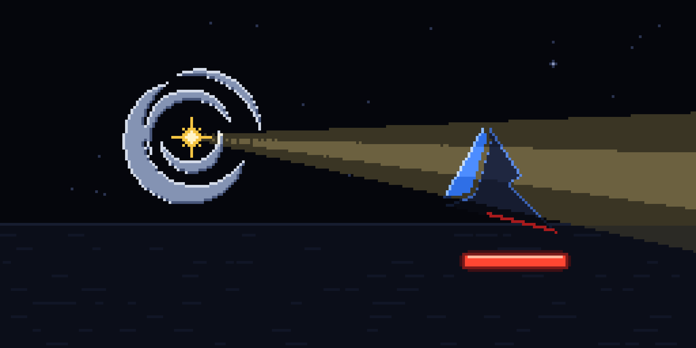

  

# Galad

**Agentes de IA, de Teresina.**

## Atalaia, nosso primeiro produto

> Multa é coisa de quem não tem Atalaia.

Feito para escritórios de contabilidade. Toda empresa recebe comunicações oficiais em caixas eletrônicas do governo, e o prazo corre mesmo que ninguém abra a mensagem. O Atalaia lê a notificação, explica o que ela pede, calcula o prazo e não deixa o caso parado.

Ainda é um protótipo, com demonstração marcada para 03/12/2026. O código e os detalhes estão em [somosgalad/atalaia](https://github.com/somosgalad/atalaia).

## Quem faz

[Nicolly](https://github.com/adlercode) e [Italo](https://github.com/itallo-dev-code), de Teresina (PI).
